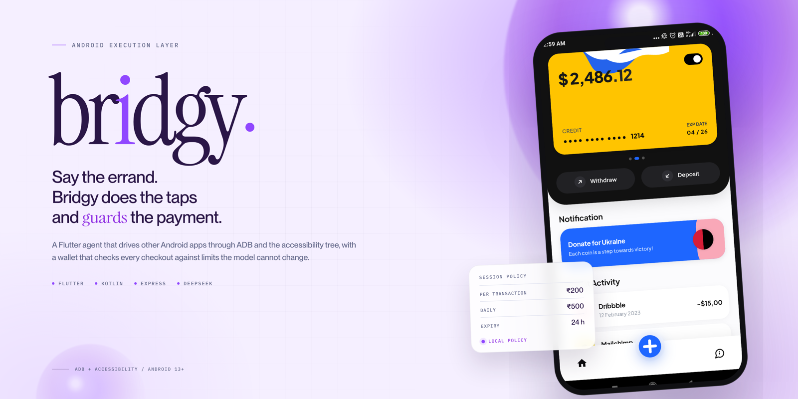
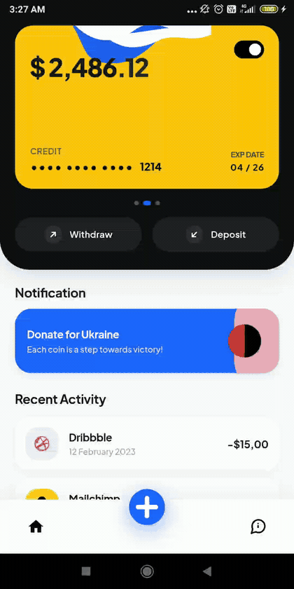
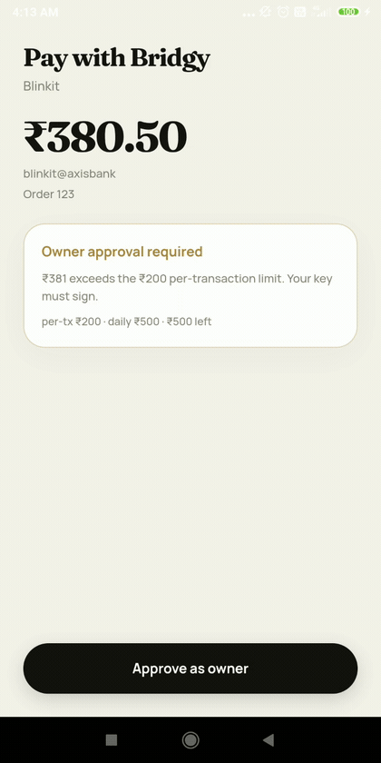
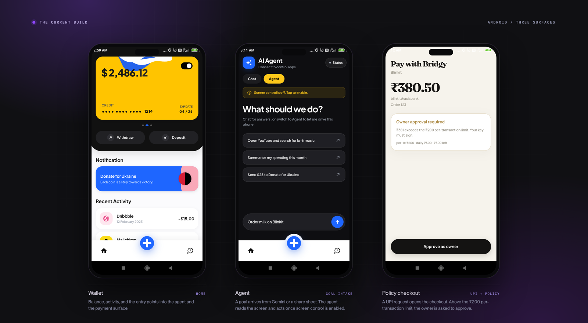
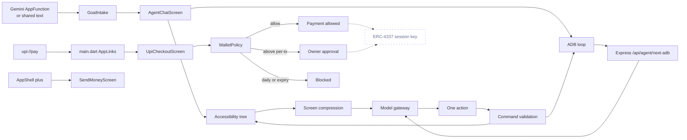

<p align="center">
  
</p>

<p align="center">
  <a href="#run-it"></a>
  <a href="#adb-execution"></a>
  <a href="#backend"></a>
  <a href="#limits-and-next-steps"></a>
</p>

**Bridgy** is an Android agent that drives other apps through ADB shell commands and the accessibility tree, then checks every checkout against spending limits the model cannot change.

It handles the errands that quick-commerce apps turn into 20 taps. The agent does the tapping. The wallet decides whether the payment is allowed.

<p align="center">
  
  
</p>
<p align="center"><sub>Recorded on the demo phone. Left: a goal arrives from the assistant. Right: a UPI request opens the policy checkout.</sub></p>

## The 20-tap problem

Ordering milk at 11pm takes about 20 taps. Open Blinkit. Wait for the storefront. Search. Pick a brand. Change the quantity. Open the cart. Choose the address. Pick a slot. Tap pay. Choose UPI. Approve.

The phone can already do every one of those steps. The assistant cannot. Android assistants read the screen and answer questions, then stop at the first button that belongs to another app. Quick-commerce apps do not expose their checkout flows, and no one is waiting for every app to ship an agent API.

Checkout is where a wrong action costs money.

## What Bridgy does

Bridgy takes a sentence, reads the live screen, and acts on the same controls a person would use. It has no partner API and no reverse-engineered endpoint.

1. A goal arrives from Gemini, a share sheet, or the app.
2. Bridgy reads the accessibility tree or a `uiautomator` dump and compresses it to labeled, tappable elements with center coordinates.
3. A model returns one action: tap, type, swipe, keyevent, or open an app.
4. Bridgy validates the action, runs it, and reads the screen again.
5. At checkout, the payment is checked against the session policy before it can proceed.

The agent does not need a special build of Blinkit or Rapido. It uses the app that is already installed. That is slower than an API and far more portable.

## The wallet is the hard part

An agent that can tap Pay is a liability. Bridgy treats the model as untrusted. The wallet holds a session policy with a per-transaction limit, a daily limit, and an expiry. Inside the limit, the policy allows the payment. Above it, Bridgy stops and asks the owner. If the daily budget or the expiry fails, the payment is blocked.

The policy is designed to be enforced twice. `lib/services/policy.dart` gives the UI an immediate decision. The same limits map to an ERC-4337 session key, so a compromised backend cannot widen them. The on-chain settlement leg is the next milestone. In this repo, nothing is charged.

## Why this shape

Two constraints shaped the build.

The model can be wrong. Every action is checked against a fixed schema before it reaches the phone. The ADB path adds a command allow-list on top. A prompt injection in a Chrome page can ask for `rm -rf`, but the command never gets that far.

The network can be slow. The demo path can replay a calibrated tap sequence without a model call. The live path is still there for screens the macro has never seen.

## What runs today

<p align="center">
  
</p>

| Surface | State |
| --- | --- |
| Wallet UI and send flow | Built; balance and history come from the backend ledger |
| Auth | Email/password, magic link, and Google button; Google needs its OAuth secret |
| Top-up | Razorpay payment links with signed webhook; needs merchant keys |
| Floating HUD | Built; started from `AgentScreen` |
| Agent chat, accessibility control, skill memory | Built; screen control must be enabled |
| ADB loop, XML parser, command allow-list | Backend and validator tested; the `AgentScreen` console is not linked from the current shell |
| Policy engine and UPI parser | Built, backend-enforced, and tested |
| UPI checkout screen | Built, tested, and routed from `main.dart` for `upi://pay` |
| Supabase sync | Required; per-user RLS and migrations live in `supabase/migrations` |
| ERC-4337 settlement | Not implemented; the receive screen shows the owner Base Sepolia address |

The current shell is Home and Agent. A `upi://pay` link opens the policy checkout as a route. Top-up opens Razorpay; the UPI ID and PIN are entered there, never in Bridgy.

The Android build is a working app shell, not a store submission. Top-up stays disabled with an explicit `PSP_NOT_CONFIGURED` error until Razorpay keys are set; Google sign-in stays disabled until the OAuth secret is set.

## System map

Solid lines are wired in this repo. Dotted lines are designed but not connected.



## Goal intake

Gemini does not get a generic "open Bridgy" hook. The app exposes one AppFunction, `runTask(goal)`. The goal is required and capped at 200 characters, so a bare "open Bridgy" request cannot start an empty agent run. `MainActivity` also accepts a text share, `SearchManager.QUERY`, and `EXTRA_TEXT`.

`GoalIntake` reads a cold-start goal once with `takeLaunchGoal` and listens for warm-start goals on an EventChannel. `AppShell.openAgent` switches to the Agent tab with the text already in the composer.

## Perception

The default path is `AgentAccessibilityService`. It walks every interactive window, skips Bridgy's own package, drops invisible and zero-size nodes, and records text, content description, class, clickable, editable, and scrollable flags, plus screen bounds.

`ScreenAutomationService` compresses the tree before it reaches the model. Each line has an index, a short type, a quoted label, tags, and a center coordinate. Body text is capped at 50 characters. Status bar noise is dropped. Task keywords get a `*`, so the model sees the likely target first.

The screen is polled until it stops changing. `waitForSettledScreenDescription` polls every 150ms, waits at least 350ms, and gives up at the action's budget: 1.5s after a tap, 3s after an app opens, 2s after typing. Stable screens move on immediately.

The ADB path uses `uiautomator dump /sdcard/window_dump.xml`. The app watches the file until the content changes and stays stable for one poll. `Backend/agent.js` parses the XML, keeps labeled or clickable nodes, converts bounds to a center, caps labels at 60 characters, and returns at most 40 nodes. Reading the dump needs All files access on the phone.

By default, the accessibility path sends compressed text, not the raw tree. The ADB path sends the XML to your server, which reduces it to 40 nodes before the model call.

## Decision

The app talks to an OpenAI-compatible proxy at `/api/chat/completions`. The OpenRouter key stays in `Backend/.env`. The APK uses the placeholder `server-proxy` and never sees it. The model is fixed to `deepseek/deepseek-v4.1-flash-1017` in the app and the proxy.

Agent mode uses a router prompt. It either answers, opens an app, reads the screen, or returns `execute_task`. The executor then runs a second, step-level prompt with a strict JSON action schema:

```json
{
  "action": "execute_task",
  "params": { "goal": "order milk on Blinkit" },
  "reasoning": "The request needs several steps.",
  "is_complete": false
}
```

The executor accepts `click_text`, `click_at`, `type_text`, `press_enter`, `scroll`, `swipe`, `press_back`, `press_home`, `open_app`, `wait`, and `done`.

It allows 15 steps by default. It retries a malformed JSON reply once, caps repeated Enter and scroll actions, and stops after five consecutive failures. A saved skill can replay a successful sequence without a model call. Skills match at a Jaccard similarity above 0.6.

Text taps prefer a real button over an editable field with the same label, so the agent clicks the visible suggestion instead of re-focusing the search box.

Chat mode uses a separate prompt and a streaming response. It does not run tools.

## ADB execution

The native bridge listens on `MethodChannel("com.bridgy.app/adb")` and exposes `runCommand`, `readScreenDump`, `screenSize`, and `launchText`.

`AdbBridge.run` strips a leading `adb shell ` before sending a command to the native channel. The native side adds `adb shell` back unless the call is raw. The macro path uses raw for `monkey` and non-raw for `input`.

The server validates every command the model returns. `Backend/agent.js` strips an optional `adb shell ` prefix, rejects commands longer than 120 characters, rejects shell metacharacters, and then matches the rest against a short allow-list.

The rejected characters are `;`, `&`, `|`, a backtick, `$`, `>`, `<`, newlines, and backslashes.

| Command | Example | Use |
| --- | --- | --- |
| `input tap` | `input tap 540 360` | Tap a node center |
| `input swipe` | `input swipe 540 1800 540 600 300` | Scroll or reveal |
| `input text` | `input text milk` | Type into a field |
| `input keyevent` | `input keyevent 66` | Enter (66) |
| `am start` | `am start -a android.intent.action.VIEW -d upi://pay...` | Open a UPI request |
| `monkey` | `monkey -p com.grofers.customerapp -c android.intent.category.LAUNCHER 1` | Launch an app |

`input text` is capped at 80 characters and allows letters, digits, `%`, `.`, `,`, `!`, `?`, `@`, `:`, `-`, and spaces. Spaces must become `%s`, which is why the model is told to write `milk%s1L`.

For most actions, the shipped agent uses `ScreenAutomationService`: accessibility gestures for taps, swipes, and text, with Shizuku as a fallback for Enter and swipes when the channel fails. The ADB loop is a separate path in `AgentScreen`.

Fast mode in `lib/services/macro.dart` picks Rapido, Blinkit, Zepto, or Chrome from the goal and replays taps. The coordinates are multiplied by 1080x2400, so recalibrate before using a different screen.

The console is a developer path. It expects a phone-side ADB endpoint that is already paired, and it is not linked from the current shell.

## Payment

The manifest registers `upi://pay` on `MainActivity` with `singleTask`. `main.dart` listens with `app_links`. `UpiIntent.parse` requires the `upi` scheme, the `pay` host, a payee (`pa`), and an amount (`am`) above zero. It reads the payee name (`pn`) and note (`tn`).

`WalletPolicy.evaluate` runs in this order:

| Check | Result |
| --- | --- |
| Amount is zero or negative | Reject |
| Policy has expired | Reject |
| Amount is above the remaining daily budget | Reject |
| Amount is above the per-transaction limit | Owner approval |
| Otherwise | Allow |

At exactly the per-transaction limit, the result is allow. The tests pin that boundary.

The defaults are ₹200 per transaction, ₹500 per day, and a 24-hour expiry. The editor and `PolicyController` hold the local copy. Supabase is optional and gated by `SUPABASE_URL` and `SUPABASE_ANON_KEY`.

`UpiCheckoutScreen` renders the decision: within policy, owner approval, or blocked. The owner sheet confirms, then `POST /api/wallet/pay-owner` debits the user's ledger balance atomically. `POST /api/wallet/pay-agent` enforces the per-tx cap, daily cap, expiry, and balance before it debits. This screen is tested in `test/upi_checkout_test.dart` and is routed from `main.dart` for `upi://pay`.

Top-up creates a Razorpay payment link (`POST /api/wallet/topup`). The app opens the link externally and polls every 2 seconds. Only the Razorpay webhook signature or a server-side payment-link status check can mark a top-up paid; the client cannot credit itself. The migration `0002_multi_tenant.sql` and `0003_debit.sql` hold the atomic `credit_topup` and `debit_wallet` functions.

The ERC-4337 design uses a ZeroDev session key with a call policy, a target allow-list, a value limit, and a timestamp policy. That code is not in this repo. The schema deliberately leaves `owner_private_key` and `agent_session_key` out; the owner key stays in `Backend/.env`.

## Backend

| Route | Auth | Purpose |
| --- | --- | --- |
| `GET /health` | none | Liveness |
| `POST /api/chat/completions` | none | OpenAI-compatible proxy with optional SSE streaming |
| `POST /api/agent/next-adb` | none | XML in, one validated ADB command out |
| `GET /api/wallet/status` | Bearer | Balance, limits, expiry |
| `GET /api/wallet/balance` | Bearer | Ledger balance |
| `GET /api/wallet/transactions` | Bearer | Recent ledger rows |
| `POST /api/wallet/topup` | Bearer | Create a Razorpay payment link |
| `GET /api/wallet/topup/:id` | Bearer | Poll and server-confirm a top-up |
| `POST /api/wallet/razorpay/webhook` | signature | Credit a paid top-up exactly once |
| `POST /api/wallet/pay-agent` | Bearer | Policy-checked debit |
| `POST /api/wallet/pay-owner` | Bearer | Owner-approved debit |
| `POST /api/wallet/renew-session` | Bearer | Extend the policy window |
| `POST /api/wallet/policy` | Bearer | Update limits |
| `GET /api/wallet/onchain` | Bearer | Base Sepolia address and ETH balance |

```http
POST /api/agent/next-adb
Content-Type: application/json

{
  "userGoal": "order milk on Blinkit",
  "screenXml": "<hierarchy>...</hierarchy>"
}
```

```json
{
  "thought": "tap the search field",
  "command": "input tap 540 360"
}
```

The endpoint returns 400 for missing fields, 422 when the dump has no usable nodes or the model returns a rejected command, and 502 when the upstream model call fails.

The proxy caps `max_tokens` at 8192, defaults `temperature` to 0.7, and sets `reasoning.effort` to low. It streams SSE when `stream` is true. The key is read from `Backend/.env`.

Every wallet route requires `Authorization: Bearer <Supabase access token>`. The backend validates it with Supabase Auth and derives the owner id from it; a missing or expired token is a 401. Wallet writes use the service-role key, which never ships in the APK.

The agent chat proxy still accepts `BRIDGY_AGENT_URL` for local development. Wallet calls do not: they always use `https://bridgy-backend.vercel.app`.

## Data and keys

`supabase/migrations` creates `profiles`, `wallets`, `transactions`, `topups`, and `terminal_logs`. Every money row has `owner_id`. A wallet row holds the limits, the balance, today's spend, and the expiry. A top-up row holds the Razorpay link id, payment id, and status.

No signing key is stored in the database. The owner key lives in `Backend/.env`; a leaked database must never leak a key.

RLS is `auth.uid() = owner_id` for select on wallets, transactions, and topups. Authenticated clients get no insert/update/delete policy; only the service role writes. The atomic credit and debit functions are granted to `service_role` only.

## Security model

| Risk | Control | What is still open |
| --- | --- | --- |
| Prompt injection in a web page or app | Closed action schema, ADB command allow-list, policy gate | An allowed tap can still hit the wrong control |
| Stolen APK or reverse engineering | OpenRouter key stays on the server; the app uses a proxy | A compromised server holds the key |
| Database leak | No signing keys in the schema | RLS is demo-permissive |
| Screen data | By default, the accessibility path sends compressed text, not the raw tree | Screen text still leaves the device to the model provider |
| Floating HUD | The overlay is app-owned and driven by local data | There is no tapjacking defense around `SYSTEM_ALERT_WINDOW` |
| Local development traffic | Cleartext is allowed for a LAN server | Use HTTPS outside a trusted network |

Do not run the agent on a banking, password, or one-time-code screen. The model sees the text it needs to choose the next action.

## Performance

The loop waits for the screen instead of sleeping for a fixed time. A stable screen returns as soon as two consecutive descriptions match.

The prompt is kept small on purpose. The accessibility path caps body text at 50 characters and the ADB path caps the node list at 40. The app reuses an HTTP client so each step does not pay for a new TLS handshake.

Configured budgets:

| Setting | Value |
| --- | --- |
| Agent steps | 15 default, 999 when the cap is disabled |
| ADB console steps | 12 |
| Accessibility settle poll | 150ms, minimum 350ms, capped by the action delay |
| Screen dump wait | 150ms poll, 1.8s timeout |
| ADB loop model call | 20s timeout |
| Chat stream | 120s timeout |

Fast mode skips the model call entirely. That is the path to use when the venue Wi-Fi is worse than the demo.

## Run it

### 1. Start the backend

```sh
cd Backend
cp .env.example .env
# Fill SUPABASE_URL, SUPABASE_ANON_KEY, SUPABASE_SERVICE_ROLE_KEY.
# Add RAZORPAY_KEY_ID, RAZORPAY_KEY_SECRET, RAZORPAY_WEBHOOK_SECRET for top-up.
# Add OPENROUTER_API_KEY for agent chat.
npm install
npm start
```

The server listens on `0.0.0.0:8787`. Restart it after changing `.env`. Check it with `curl http://localhost:8787/health`.

Run the backend tests with `cd Backend && npm test`.

Apply the database migrations once, in order, from `supabase/migrations` (Supabase SQL editor or `supabase db push`).

### 2. Run the app

```sh
flutter pub get
flutter run
```

The wallet backend is `https://bridgy-backend.vercel.app`. Agent chat can point elsewhere with `--dart-define=BRIDGY_AGENT_URL=...`; wallet calls cannot, so a misconfigured localhost build cannot break payments.

The Android emulator reaches a host server at `http://10.0.2.2:8787` for chat.

Supabase is configured in `lib/services/backend.dart` with the project URL and the public anon key. Override them per environment:

```sh
flutter run \
  --dart-define=SUPABASE_URL=https://<project>.supabase.co \
  --dart-define=SUPABASE_ANON_KEY=<publishable-key>
```

The app opens on a sign-in gate. Email/password and magic link work without extra configuration. Google additionally needs a Google Cloud OAuth client (Web), its client id and secret pasted into Supabase **Authentication > Providers > Google**, and `bridgy://login-callback` in the redirect allow list. Email signup confirmation relies on Supabase SMTP; add custom SMTP for reliable delivery.

Release builds need `android/key.properties` and `android/app/bridgy-release.jks`. Both are gitignored. Missing files fail the build instead of falling back to the debug key.

### 3. Set up the phone

1. Enable Developer options and Wireless debugging.
2. Pair the phone once with `adb pair <ip>:<port>`, then connect with `adb connect <ip>:<port>`.
3. Open Bridgy, go to Agent, and enable **Bridgy Screen Control** in Accessibility.
4. Grant **Display over other apps** for the HUD.
5. Grant **All files access** if you want the ADB console to read `window_dump.xml`.

On Android 13 and newer, an adb-installed build can hide the accessibility toggle under restricted settings. The standard fix is:

```sh
adb shell appops set com.bridgy.bridgy ACCESS_RESTRICTED_SETTINGS allow
```

Some OEM builds name this app-op differently. If the command fails, enable restricted settings from the app info screen instead.

### 4. Build note

Gradle 8.14 rejects the JBR 25 that Android Studio ships on some machines. Point Flutter at a JDK 21 install:

```sh
flutter config --jdk-dir /path/to/jdk-21/Contents/Home
```

## Tests

```sh
flutter test
cd Backend && npm test
```

| Test file | What it covers |
| --- | --- |
| `test/policy_test.dart` | Per-transaction boundary, daily cap, expiry, UPI parsing |
| `test/upi_checkout_test.dart` | Allow, owner approval, block, malformed link, API error |
| `test/auth_screen_test.dart` | Email, password, magic link, validation, Google button |
| `test/top_up_screen_test.dart` | Razorpay link, polling, paid credit, PSP error, expiry |
| `test/receive_screen_test.dart` | On-chain address, ETH balance, RPC error |
| `test/macro_test.dart` | App selection, ADB-safe query, launch and tap order |
| `test/widget_test.dart` | Home, send, agent, composer, font loading |
| `Backend/agent.test.js` | XML centers, allow-list, metacharacters, fenced JSON |
| `Backend/auth.test.js` | Missing, invalid, valid, and unavailable auth |
| `Backend/ledger.test.js` | Wallet read, top-up, idempotent credit, debit |
| `Backend/razorpay.test.js` | Paise conversion, signature, config errors |

The widget tests load Plus Jakarta Sans through `FontLoader`. Without it, Ahem metrics cause RenderFlex overflows.

## Limits and next steps

- Wire the ERC-4337 session key and the owner validator on Base Sepolia. `GET /api/wallet/onchain` currently exposes the owner EOA, not a Kernel account.
- Add Razorpay merchant keys, then run one live ₹1 UPI payment and verify the webhook credit.
- Add a Google OAuth client secret so the Google button works; email auth already works.
- Link the ADB console into `AppShell`.
- Add crash reporting and a Play internal-test upload. The signed AAB is built; the Play account step is external.
- Recalibrate `lib/services/macro.dart` for the target screen. It multiplies by 1080x2400.

Cross-app control is Android-only. The iOS target is not supported.

## Repository map

```text
lib/
  main.dart                 app entry, UPI links, overlay entry
  screens/                  wallet, agent chat, ADB console, policy, UPI checkout
  services/                 agent loop, accessibility, ADB, policy, UPI, AI
  state/                    wallet and policy controllers
  overlay/                  floating HUD
android/
  MainActivity.kt           MethodChannel bridge, goal intake
  AgentAccessibilityService.kt
  BridgyAppFunctions.kt     Gemini AppFunction
Backend/
  server.js                 Express routes, auth gate, Razorpay webhook
  auth.js                   Supabase JWT middleware
  ledger.js                 Per-user wallet, top-up, debit
  razorpay.js               Payment links and signature checks
  wallet.js                 Optional ZeroDev owner/session keys
supabase/migrations/        profiles, multi-tenant RLS, credit/debit RPCs
docs/media/                 README images and GIFs
test/                       policy, UPI, macro, widget tests
tool/preview.dart           web preview for the send and agent screens
```

## Credits

The README art direction follows the type and colour reference in `replicate-this/` (Emotion Agency). The reference fonts were used to render the images and are not redistributed with the app. The Bridgy wordmark is an original mark in that style. The app, agent, and wallet code are Bridgy's.

No license file is included yet. Add one before distributing the project.
